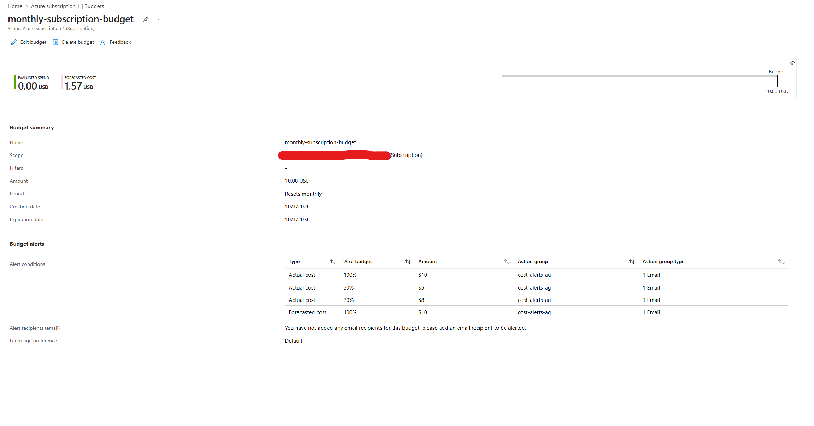
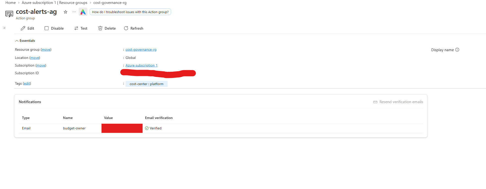
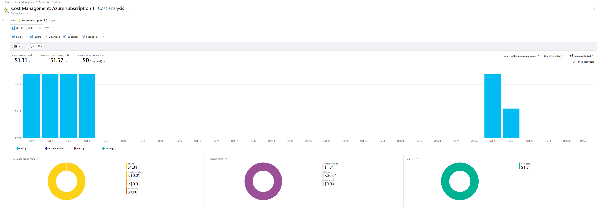
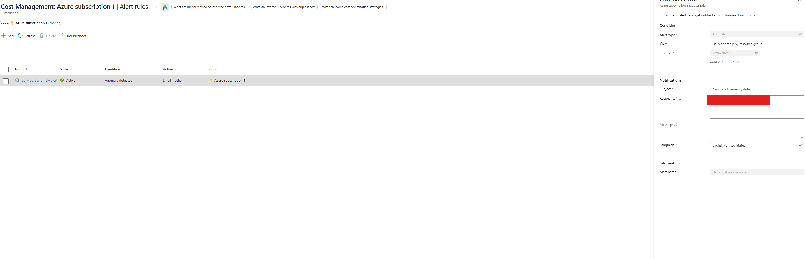
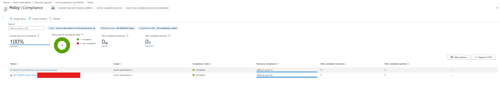

# 💰 Azure Cost Visibility & Guardrails
### Budget alerts · Forecast warnings · Weekly cost report · Anomaly detection · Cost-attribution policy


A cost feedback loop for an Azure subscription, defined entirely in Terraform. It is a companion to my [Personal Azure Infrastructure](https://github.com/MrBSykes/personal-azure-infrastructure-terraform-IAC) project: that repo is the platform, this one governs what it costs.

> **Status:** all 8 resources deployed to my own subscription and verified in the portal (screenshots below). The weekly-report screenshot is still pending, and sections marked *(to verify)* are claims I have not yet proven.

---

## 1. The Business Problem

*Fictional scenario, built to practice a real-world problem.*

A non-profit moved its operations into Azure and, for the first few months, stayed within budget and paid on time. As the team deployed more resources, monthly spend climbed. Nobody was tracking it, and nobody owned it. By month six, leadership was cutting budgets in other programs to cover a growing cloud bill. Going into month seven, the organization nearly missed a payment, and the manager learned about the overrun from the invoice, not from any warning.

**The root problem is the absence of a feedback loop.** Cost was visible only after it was incurred, and no one could say which resources or projects were driving it.

**Intended outcome:** the budget owner hears about a spending problem within about a day, and before the month ends, and can say which project caused it. (Azure cost data lags by hours, so this is near-real-time, not instant.)

---

## 2. Azure Resources and Why They Are Here

| Resource | Why it is here | Problem it solves |
|---|---|---|
| **Budget** (`azurerm_consumption_budget_subscription`) with four alerts: 50% actual, 80% actual, 100% **forecasted**, 100% actual | Warns at escalating levels. The forecast alert predicts the month-end total from current spend | "Nearly missed a payment": the manager is warned *before* the limit is reached |
| **Action group** (`azurerm_monitor_action_group`) | One reusable notification target that the budget points to | Change who is alerted in one place; add channels later without touching the budget |
| **Saved cost view** (`azurerm_subscription_cost_management_view`) | Month-to-date spend grouped by resource group | Gives the manager a ready-made answer to "where is the money going?" |
| **Scheduled weekly report** (`azurerm_cost_management_scheduled_action`) | Emails that view every Monday | A non-technical manager will not open the portal, so the report comes to them |
| **Anomaly alert** (`azurerm_cost_anomaly_alert`) | Flags unusual daily spend | Catches a forgotten resource without waiting for the monthly total |
| **Tag policy** (custom definition and assignment) | Reports any resource group missing a `cost-center` tag | Makes spend attributable: a spike can be traced to a project |
| **Resource group** `cost-governance-rg` | Holds the action group | Keeps governance resources separate from workloads |

---

## 3. Key Architectural Decisions

| # | Decision | Reasoning | Trade-off |
|---|---|---|---|
| 1 | **Forecast alert, not just actual** | Actual-only alerts arrive when the money is already spent. Forecast warns while there is still time to act | Forecasts need some usage history to be meaningful, and can be noisy early in a month *(to verify)* |
| 2 | **Tiered thresholds (50, 80, 100)** | Different levels create different responses: awareness, planning, action | More emails. Four notifications is well under the budget limit of five |
| 3 | **Policy starts in `Audit`, not `Deny`** | Existing untagged resource groups (including my network project's) would block updates under `Deny`. Audit reports first, so nothing breaks | Audit does not prevent untagged groups. Flip `tag_policy_effect` to `Deny` once everything is tagged |
| 4 | **Policy mode `All`** | `Indexed` mode skips resource groups, which would make the rule silently do nothing | Evaluates more resource types |
| 5 | **Separate state file** (`cost-governance.terraform.tfstate`) in the existing state account | A mistake here cannot touch the network project, and vice versa | One extra state key to manage |
| 6 | **Email goes to the budget owner via variables** | The real address stays out of Git (`TF_VAR_alert_email`), and a deployer sets their own | Setup step for anyone cloning |
| 7 | **Weekly emailed report, not a hand-built dashboard** | Pushing a short report to the manager works better than asking them to visit a dashboard, and avoids brittle dashboard JSON | Less interactive than a live dashboard |
| 8 | **No automated shutdown** | Alerts inform; they do not stop spending, and auto-deleting resources is risky without testing | The honest limit of this project, see below |

### Known limitations

- **Budgets alert, they do not stop spending.** A natural next step is an automated response, such as an action group that triggers a runbook to stop non-essential resources.
- **Cost data lags by hours**, and budgets are evaluated on a schedule, so alerts are not instant.
- **Anomaly alerts are sent based on the creator's access** at send time, per the provider documentation, so the alert owner should keep their access.
- **Single subscription.** A larger organization would scope budgets at a management group and add per-team budgets filtered by tag.

---

## 4. How to Deploy

### Prerequisites

- Terraform 1.3 or newer and the Azure CLI, signed in with `az login`
- A subscription where you can create budgets and policy assignments (Owner or Contributor plus Resource Policy Contributor)
- The remote state account from the [network project](https://github.com/MrBSykes/personal-azure-infrastructure-terraform-IAC), or edit the `backend` block in `terraform/providers.tf` to your own

### Steps

```powershell
cd terraform
$env:TF_VAR_subscription_id = az account show --query id -o tsv
$env:TF_VAR_alert_email = "you@example.com"   # a real address, or alerts go nowhere

terraform init
terraform plan
terraform apply
```

Defaults: a $10 monthly budget, budget start `2026-10-01`, weekly report every Monday from `2026-11-02`. Override with `-var` or a gitignored `terraform.tfvars`.

### Cost

Budgets, action groups (email), cost views, scheduled reports, anomaly alerts and policy assignments carry no charge as far as I know *(to verify on the pricing pages)*. Nothing here deploys billable compute or networking.

### Tear down

```bash
terraform destroy
```

---

## Repository Layout

```
.
├── README.md
├── screenshots/                  # portal evidence of the deployed resources
└── terraform/
    ├── providers.tf              # provider and remote backend
    ├── variables.tf              # email, budget amount, dates, tag policy
    ├── main.tf                   # action group, budget, cost view, report, anomaly alert
    ├── policy.tf                 # cost-attribution tag policy
    ├── outputs.tf
    └── terraform.tfvars.example
```

## Screenshots

| # | Screenshot | What it shows |
|---|---|---|
| 01 |  | Budget `monthly-subscription-budget`: $10 per month, four alert conditions (50%, 80% and 100% actual; 100% forecasted), all routed to `cost-alerts-ag`. The portal's "no email recipients" line refers to direct emails; alerts go through the action group |
| 02 |  | Action group `cost-alerts-ag` with the email receiver **Verified** and the `cost-center` tag applied |
| 03 |  | Cost analysis view built by Terraform: month-to-date spend by resource group, service and tag. $1.31 so far, $1.57 forecast, almost all of it in `dev-rg` and billed under Virtual Network, consistent with the private endpoint. All of it shows as **Untagged**, which is exactly the attribution gap the tag policy reports |
| 04 |  | Anomaly alert rule: active, daily, scoped to the subscription |
| 05 |  | Policy compliance for the tag policy, viewed at the `cost-governance-rg` scope (1 of 1 compliant, since that group carries the tag). A subscription-wide view of the untagged groups is a planned follow-up |
| 06 | *pending* | Weekly cost report scheduled action |

A budget evaluates on a schedule, and cost data lags, so the budget page shows $0.00 evaluated spend even though cost analysis shows $1.31. That is the delay described in the limitations above.

---

## Troubleshooting Log

| # | Issue | Root cause | Resolution |
|---|---|---|---|
| 1 | Cost view creation failed: `400 Non table views should have three pivots` | Cost Analysis charts other than tables require exactly three pivots (the sub-views shown under the chart). The provider docs state this, and I missed it | Added three `pivot` blocks (resource group, service, and the `cost-center` tag) |
| 2 | The same error appeared again after the "fix" | The edited file had not been saved to disk, so Terraform ran the old code. The plan said "2 to add" both times, so the plan alone did not reveal it | Verified the file contents with `grep` before re-running. Lesson: confirm the code on disk matches what you think you are applying |

---

## What I Would Do Differently Next Time

1. Create the budget and alerts on day one of the subscription, before the first deployment.
2. Decide the tag standard up front and tag every resource group at creation.
3. Scope budgets per team or project, not only per subscription.
4. Add an automated response for the 100% alert, not just an email.

## Next Steps

- [x] Deploy and verify in the portal
- [ ] Add the weekly-report screenshot and trigger a test alert by lowering the budget
- [ ] Re-capture policy compliance at the subscription scope to show untagged groups
- [ ] Tag existing resource groups, then switch the policy to `Deny`
- [ ] Add a per-tag budget for one project
- [ ] Add an automated response to the 100% actual alert

---

*Bryan Sykes | Home Lab Portfolio | 2026*
